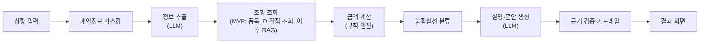

# 기준대로 (By the Book)

> 소비자 피해, 기준대로 따져봅니다.
> 상황을 말로 설명하면 공식 기준 조항을 찾고, 고시의 계산식대로 보상 기준 금액을 계산해 주는 생성형 AI 서비스


> ⚠️ **현재 개발 중인 학생 프로젝트입니다.** 아래 기능 중 일부는 아직 구현되지 않았으며, 진행 상황은 [로드맵](#-로드맵)에서 확인할 수 있습니다.

---

## 📌 해결하려는 문제

세탁소가 옷을 망가뜨리거나, 수리한 가전이 같은 고장으로 또 멈추거나, 헬스장이 환불을 거부할 때 소비자는 **"기준상 무엇을, 얼마나 요구할 수 있는지"** 모릅니다.

- **기준은 있지만 찾기 어렵습니다.** 공정거래위원회 고시 「소비자분쟁해결기준」에 품목별 교환·환불·배상 기준이 있지만, 수십 개 업종의 별표로 나뉜 긴 문서입니다.
- **계산이 복잡합니다.** 세탁 사고는 내용연수와 사용일수에 따른 배상비율, 가전은 정액 감가상각과 가산금, 헬스장은 이용일수와 위약금 상한을 계산해야 합니다.
- **사업자와 정보 비대칭이 있습니다.** 사업자는 기준을 알고, 소비자는 모르는 상태에서 협상하게 됩니다.

## ✨ 주요 기능

| 기능 | 설명 |
|---|---|
| **상황 분석과 조항 매칭** | 평소 말로 쓴 상황에서 품목·피해 유형·구입일·금액을 추출하고, 해당 고시 조항을 검색(RAG)합니다. 빠진 정보는 최소한의 추가 질문으로 묻습니다. |
| **보상 기준 계산기** | 고시의 계산식대로 **코드(규칙 엔진)** 가 배상·환급 기준 금액을 계산하고, 계산 과정을 단계별로 보여 줍니다. |
| **근거 카드와 다음 행동** | 근거 조항 원문·출처·기준일, 업체에 보여 줄 요약 문안, 1372·피해구제 신청 등 다음 행동을 안내합니다. |
| **불확실성 표시** | 모든 결과를 `✅ 기준 확인` `🔍 추가 확인 필요` `⚠️ 주의 신호` `❔ 판단 불가` 중 하나로 표시합니다. |
| **판단 가드레일** | "소송하면 이기나요?" 같은 승패·법적 효력 판단은 하지 않고, 공식 상담 창구로 연결합니다. |

## 🎯 차별점

범용 AI 챗봇에 같은 질문을 하면 그럴듯한 금액을 답하지만, 계산이 틀리거나 근거 조항이 없는 경우가 있습니다. 기준대로는 역할을 나눕니다.

- **LLM은 숫자를 만들지 않습니다.** 금액은 규칙 엔진만 계산하고, LLM은 결과를 설명합니다.
- **근거가 없는 문장은 내보내지 않습니다.** 답변이 인용한 조항이 검색 결과에 없으면 그 문장을 제거합니다.
- **모든 결과에 기준일을 표시합니다.** 고시가 개정되면 규칙 파일만 교체합니다.

## 🗂 지원 품목

| 구분 | 품목 | 대표 분쟁 | 계산 규칙 |
|---|---|---|---|
| **MVP** | 체육시설업 (헬스장) | 중도 해지 시 환급 거부·과다 공제 | 계약금액 − 이용분 − 위약금 (상한 적용) |
| MVP 이후 확장 | 세탁업 | 세탁 사고로 인한 훼손·분실 | 구입가격 × 배상비율 (내용연수 대비 사용일수) |
| MVP 이후 확장 | 가전·전자제품 | 반복 고장, 부품 미보유로 수리 불가 | 동일 하자 반복 시 교환·환급 요건, 정액 감가상각 + 가산금 |

> 계산 규칙의 세부 내용은 고시 원문을 기준으로 정리하며, 각 규칙 파일에 출처와 기준일을 기록합니다.

## ⚙️ 동작 방식



## 🛠 기술 스택

| 구분 | 기술 |
|---|---|
| Frontend | React + TypeScript (Vite) |
| Backend | FastAPI, Pydantic |
| AI | LLM API (모델 교체 가능한 어댑터 구조) |
| 검색 | Chroma (벡터 DB), 한국어 지원 임베딩 모델 |
| 계산 | Python 규칙 엔진, pytest |
| 평가 | Python 스크립트, SQLite |

## 📁 폴더 구조

```text
by-the-book/
├── backend/
│   ├── api/            # FastAPI 라우터
│   ├── llm/            # LLM 어댑터, 프롬프트
│   ├── rag/            # 청킹·임베딩·검색
│   ├── rules/          # 품목별 계산 엔진
│   ├── data/rules/     # 배상비율표 등 규칙 JSON (출처·기준일 포함)
│   └── tests/          # 계산 단위 테스트
├── frontend/           # React 화면
└── eval/               # 테스트 사례, 평가 지표 계산 스크립트
```

## 🚀 시작하기

> 구현이 진행되면 실제 명령어에 맞게 갱신합니다.

### 1. 환경 변수

명령은 Windows PowerShell 기준입니다.

`backend/.env.example`을 `backend/.env`로 복사하고 값을 채웁니다. API 키는 코드나 저장소에 올리지 마세요.

```env
LLM_PROVIDER=사용할_LLM_제공자
LLM_API_KEY=발급받은_API_키
LLM_MODEL=사용할_모델_이름
```

### 2. 백엔드 실행

의존성은 `backend/pyproject.toml`에 정의되어 있습니다 (Python 3.12 이상, 개발 환경 3.13).

```powershell
cd backend
py -3.13 -m venv .venv
.venv\Scripts\Activate.ps1
pip install -e ".[dev]"
uvicorn main:app --reload
```

`Activate.ps1` 실행이 막히면 `Set-ExecutionPolicy -Scope CurrentUser RemoteSigned`를 한 번 실행한 뒤 다시 시도하세요.

### 3. 프론트엔드 실행

```powershell
cd frontend
npm install
npm run dev
```

### 4. 테스트

```powershell
cd backend
.venv\Scripts\Activate.ps1
pytest
```

## 📊 평가 지표

| 지표 | 측정 방법 | 목표 |
|---|---|---|
| 정보 추출 정확도 | 품목·금액·날짜 추출 결과를 정답과 비교 | 90% 이상 |
| 조항 매칭 정확도 | 선택한 조항이 정답 조항과 일치하는 비율 | 85% 이상 |
| 계산 정확도 | 규칙 엔진 결과를 손계산 정답과 비교 | 100% |
| 근거 없는 주장 발생률 | 근거 조항이 없는 주장의 비율 | 5% 이하 |
| 판단 보류율 | 승패·법적 효력 질문을 올바르게 보류한 비율 | 95% 이상 |
| 범용 LLM 비교 | 같은 사례를 범용 LLM에 물었을 때와 정확도 비교 | 차이를 정량 제시 |

## 🗺 로드맵

- [ ] **1주차** 기획, 고시 원문 수집, 규칙 데이터 정리, 테스트 사례 30건 구축
- [ ] **2주차** 계산 엔진과 단위 테스트
- [ ] **3주차** 정보 추출·계산 API·배지
- [ ] **4주차** 근거 카드·요약 문안·가드레일, 화면 연결
- [ ] **5주차** 세탁·가전 확장과 고시 조항 검색(RAG), 테스트 사례 평가, 개선, 기능 동결
- [ ] **6주차** 배포, 발표 준비

## ⚖️ 유의사항

- 소비자분쟁해결기준은 **분쟁 해결을 위한 권고 기준**입니다. 이 서비스는 "얼마를 받을 수 있다"가 아니라 "기준상 이렇게 정해져 있다"를 안내하며, 업체가 기준과 다르게 답할 수 있습니다.
- 이 서비스는 **법률 자문이 아닙니다.** 승패나 법적 효력을 판단하지 않고, 내용증명 등 법률 문서를 작성하지 않습니다.
- 구체적인 분쟁은 아래 공식 창구에 문의하세요.
  - 1372 소비자상담센터 (☎ 1372)
  - 한국소비자원 피해구제 신청
  - 대한법률구조공단 (☎ 132)
- 상황 설명에 **이름·전화번호·계좌번호 등 개인정보를 입력하지 마세요.** 서비스는 입력한 사례 원문을 저장하지 않습니다.

## 📚 데이터 출처

| 데이터 | 출처 |
|---|---|
| 소비자분쟁해결기준 (고시 원문과 별표) | 국가법령정보센터, 한국소비자원 |
| 계속거래 해지 위약금 산정기준 | 공정거래위원회 |
| 소비자 피해구제 정보 (평가용 사례) | 공공데이터포털 |

각 규칙 파일과 결과 화면에 출처와 기준일을 함께 표시합니다.

## 📄 라이선스

이 프로젝트는 [MIT License](LICENSE)를 따릅니다. 단, 고시 원문 등 공공 데이터는 각 출처의 이용 조건을 따릅니다.
